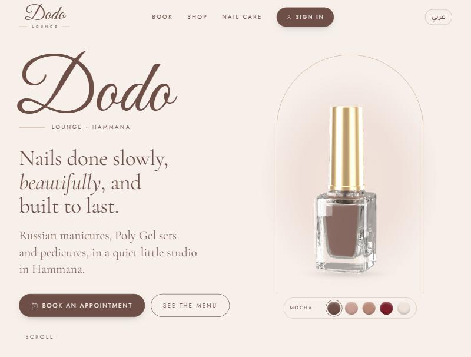
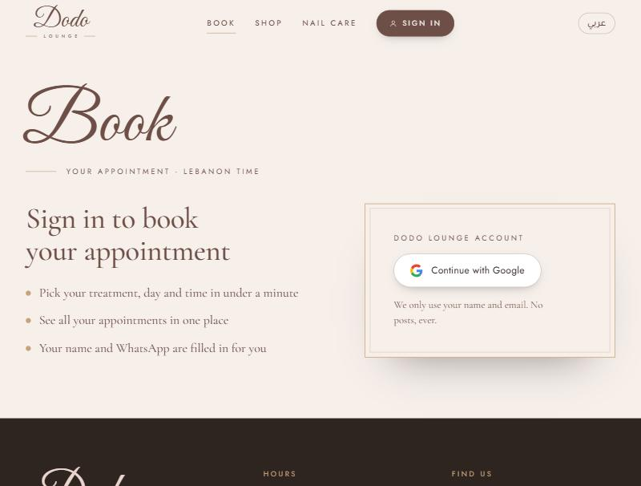

# Dodo Lounge: booking and online shop for a nail studio

**Live at [dodolounge.com](https://dodolounge.com)** · Built by [Rami Fayad](https://github.com/Rami14214), 2026

The studio used to take every appointment through Instagram messages. I designed and built a website where clients see the real menu, pick a staff member and a free time, and book in under a minute. Staff run bookings and shop orders from a private dashboard.

> This repo is a **showcase**. The full source is private because it runs a real business. The files in [`code/`](code) are real excerpts from it. I'm happy to walk through the whole codebase in an interview.

## Screenshots

| Home (3D polish bottle with a shade picker) | Booking (Google sign-in) |
| --- | --- |
|  |  |

## Stack

**Backend:** Python 3.12, FastAPI, Pydantic, Jinja templates
**Database and auth:** PostgreSQL on Supabase, Supabase Auth (Google sign-in), Row Level Security
**Frontend:** HTML, CSS, JavaScript, GSAP and Lenis for motion, a pre-rendered 3D polish bottle
**Quality and hosting:** pytest (95 tests), deployed on Render (Frankfurt, next to the database)
**Extras:** Arabic and English, Google Calendar sync for staff, WhatsApp hand-off for confirmations

## The interesting parts

### 1. The database makes double bookings impossible
Checking availability in Python isn't enough: two clients can click "Book" at the same moment. So the rule also lives in PostgreSQL, as an exclusion constraint. The database refuses any two live bookings that overlap for the same staff member, whatever the app does.

```sql
constraint bookings_no_overlap exclude using gist (
  staff with =, tstzrange(start_at, end_at) with &&
) where (status in ('unsent', 'pending', 'confirmed'))
```

A trigger also forces every booking made by a client account to start as `unsent`, so a client can never create a booking that is already confirmed. → [`code/schema.sql`](code/schema.sql)

### 2. A scheduling engine with real salon rules
Each service has its own duration and start times, on Beirut time. Some services use fixed slots; Saturday pedicures pack back to back and jump past existing bookings; some staff keep a lunch hour free on weekdays; Sunday is closed. The engine is pure Python (no database, no web), so it is easy to test. → [`code/slots.py`](code/slots.py), [`code/test_slots.py`](code/test_slots.py)

### 3. Security from day one
Every response goes through one middleware ([`code/security_middleware.py`](code/security_middleware.py)):
- a strict Content Security Policy with a fresh nonce per request, and no clickjacking (`frame-ancestors 'none'`)
- cross-site POSTs blocked by checking the `Origin` header (CSRF protection)
- HSTS and secure, `SameSite=Lax` session cookies in production
- `no-store` caching on account, admin and API pages
- staff access via Google sign-in plus an email allow-list: removing an email removes access

### 4. Tested
95 pytest tests cover the slot engine, the API, staff permissions, security headers, the Arabic translation and the calendar sync. Some examples: [`code/test_api_excerpt.py`](code/test_api_excerpt.py).

## What I'd do next
- Online payment for shop orders
- SMS reminders the day before an appointment
